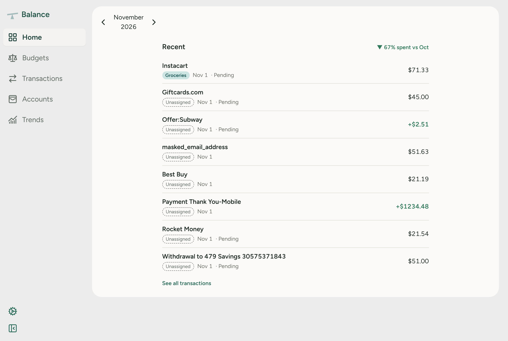
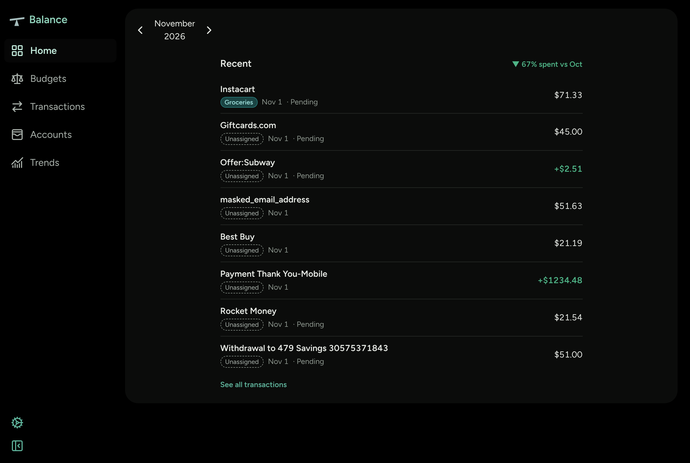

# Balance

Balance is a personal budgeting app. You record transactions across your accounts, put them into budget categories, and see where your money goes from month to month. You can also link a US bank through Plaid and have its transactions imported for you.

**Live site:** [balance.joshwanf.com](https://balance.joshwanf.com)

| Light | Dark |
| ----- | ---- |
|  |  |

## Features

- **Home**: a Recent transactions card with the month's latest transactions, and spending shown up or down against the same point last month.
- **Accounts**: create, rename and delete checking and credit accounts. Each transaction belongs to one account.
- **Linked banks**: link a bank with Plaid Link and its checking, savings and credit accounts and their transactions come in automatically. A bank syncs when it is linked, from a Sync now button, and again whenever it has gone 12 hours without one. Imported transactions only get a category when one of yours already matches.
- **Bank sync health**: each linked bank on Accounts shows whether it is syncing, hasn't synced in a day, or needs you to sign in again, with a Reconnect button for the last case.
- **Transactions**: record incoming and outgoing transactions with a payee, amount, date, account, category and any number of tags.
- **Search**: filter transactions with a query syntax that mixes free text with key/value filters, e.g. `coffee tags:"work, travel" startDate:2024-01-01`.
- **Budgets**: create spending categories and set a budgeted amount for each one per month. Each category shows what you have spent against its budget, and turns red when you overspend. The month's Spent and Brought in totals sit at the top.
- **Category colours**: each new category gets a colour of its own, which you can change. It shows on category chips, budgets and the trend charts.
- **Tags**: label transactions with free-form tags for grouping that cuts across categories.
- **Trends**
  - *Overview*: a bar chart of incoming and outgoing totals by category over a range of months you choose.
  - *Compare*: pie charts that put two months' spending side by side, split by category.
- **Light and dark themes**: follows your OS setting by default, with a switcher to pick one. The dark theme uses true black for OLED screens.
- **Works on phones**: every page adapts to small screens.
- **Accounts and sessions**: sign up, log in and log out, with sessions kept in an HTTP-only JWT cookie. A demo user is available from the login form.

## Tech stack

| Layer      | Technologies |
| ---------- | ------------ |
| App        | Next.js 16 (App Router) with Server Components and Server Actions, React 19, TypeScript, Tailwind CSS with colours as CSS variable tokens, Chart.js (`react-chartjs-2`), Motion, Lucide icons, dayjs |
| API        | Next.js Route Handlers with REST endpoints under `/api`, zod validation, bcrypt password hashing, JSON Web Tokens |
| Banking    | Plaid (`plaid`, `react-plaid-link`), with access tokens encrypted at rest |
| Database   | PostgreSQL via Prisma ORM |
| Deployment | Vercel, with the project's Root Directory set to `apps/web` |

Money is stored as integer cents. A `Money` class handles parsing, arithmetic and formatting, so no floating-point rounding errors creep in.

## Project structure

The repo is a yarn workspace with the app and a shared types package.

```
balance/
├── apps/web/                 Next.js app
│   ├── prisma/               Prisma schema, migrations and seed data
│   ├── scripts/              Command-line tools, such as the Plaid sync
│   └── src/
│       ├── app/              Pages (/, /my-balance/...) and API routes (app/api)
│       ├── server/
│       │   ├── actions/      Server Actions called by forms and buttons
│       │   ├── data/         Reads and writes; the only code that uses Prisma
│       │   ├── plaid/        Plaid client, linking, sync and token encryption
│       │   └── ...           Auth, config, Prisma client, errors, zod schemas
│       ├── components/       Home, Accounts, Budgets, Categories, Transactions, Trends, Landing, Main
│       ├── lib/              Shared UI component library
│       ├── theme/            Light/dark theme, chart colours, category colours
│       ├── hooks/            URL state and scroll helpers
│       └── utils/            Money class, dates, search parsing, helpers
├── packages/api-types/       Request and response types shared by the API and the client
└── package.json              Workspace root and scripts
```

## How data flows

Pages under `/my-balance` are Server Components. They read through `server/data`, which is the only code that talks to Prisma and is marked `server-only`. Forms and buttons call Server Actions in `server/actions`. Each one that changes data goes through `userMutation` (`server/mutation.ts`), which checks the session and revalidates the `/my-balance` layout so every page shows the change. The month and search live in the URL, so a page can be shared or reloaded as it is.

## API

The app itself uses Server Actions, but the same data is also available as a REST API. All endpoints are under `/api` and need a logged-in session except `GET`/`POST`/`DELETE /api/session`, `POST /api/users` and `GET /api/health`.

| Resource     | Endpoints |
| ------------ | --------- |
| Session      | `GET /session` (restore), `POST /session` (log in), `DELETE /session` (log out), `POST /users` (sign up) |
| Accounts     | `GET /accounts?startMonth=`, `POST /accounts`, `PATCH /accounts/:id`, `DELETE /accounts/:id` |
| Categories   | `GET /categories?startMonth=`, `POST /categories?startMonth=`, `GET`/`PATCH`/`DELETE /categories/:id`, `DELETE /categories?ids=a,b` |
| Transactions | `GET /transactions?startMonth=&endMonth=`, search with `?q=&startDate=&endDate=&tags=`, `POST /transactions`, `GET`/`PATCH`/`DELETE /transactions/:id` |
| Tags         | `GET /tags`, `POST /transactions/:id/tags`, `DELETE /transactions/:id/tags?names=a,b` |
| Trends       | `GET /trends/overview?startMonth=&endMonth=`, `GET /trends/compare?month1=&month2=` |

## Getting started

### Prerequisites

- Node.js 20.9 or later
- Yarn 1
- A PostgreSQL database

### Setup

1. Install dependencies from the repo root:

   ```sh
   yarn install
   ```

2. Configure the environment:

   ```sh
   cp apps/web/.env.example apps/web/.env
   ```

   Set `DATABASE_URL_SCHEMA` to your Postgres connection string and `JWT_SECRET` to a long random string. The app does not start without `JWT_SECRET`.

   Bank linking is optional and stays hidden while the Plaid variables are empty. To turn it on, set `PLAID_CLIENT_ID` and `PLAID_SECRET_SANDBOX` from your Plaid dashboard, leave `PLAID_ENV=sandbox`, and generate a token key:

   ```sh
   openssl rand -base64 32
   ```

   Put the result in `PLAID_TOKEN_KEY`. It encrypts the stored bank tokens, so every environment that shares a database, such as your machine and Vercel, needs the same key. `PLAID_WEBHOOK_URL` is not used yet.

3. Apply the migrations and seed the demo data:

   ```sh
   yarn workspace @balance/web deploy-prisma
   yarn seed
   ```

   The demo user logs in with `admin` / `password`. With Plaid configured, the demo user gets a Sandbox bank linked automatically.

4. Start the dev server:

   ```sh
   yarn dev
   ```

### Scripts

Run these from the repo root.

| Command           | Description |
| ----------------- | ----------- |
| `yarn dev`        | Start the Next.js dev server |
| `yarn build`      | Generate the Prisma client and build the app |
| `yarn start`      | Serve the production build |
| `yarn type-check` | Type-check the app |
| `yarn migrate`    | Create and apply a Prisma migration |
| `yarn seed`       | Seed the demo user and data |
| `yarn workspace @balance/web deploy-prisma` | Apply migrations without creating new ones |
| `yarn plaid:sync link-sandbox <username>` | Link a Plaid Sandbox bank to a user and sync it |
| `yarn plaid:sync sync <item id>`          | Sync one linked bank (`sync all` syncs every active one) |
| `yarn plaid:sync reset-login <item id>`   | Make a Sandbox bank ask for sign-in again, to test Reconnect |

The Plaid commands read `apps/web/.env`. `link-sandbox` and `reset-login` only work with Sandbox.

## Deployment

The app runs on Vercel with the project's Root Directory set to `apps/web`, and a hosted Postgres database such as Neon. Set the same variables as in `.env` in the Vercel project, and run `deploy-prisma` against the database when a release adds migrations.

## License

MIT
